# Splunk SIEM Threat Detection Lab

A home SOC lab that simulates a full attack chain from a Kali Linux VM against a Windows 11 host, then detects each stage in Splunk Enterprise using Sysmon telemetry. Detections are mapped to MITRE ATT&CK, visualised in a five-panel dashboard, and enriched automatically by a Python script that queries the Splunk REST API and VirusTotal.

| Attack stage | Technique | Detection signal | Events |
|---|---|---|---|
| Port scan (Nmap) | T1046 | Sysmon EventCode 3 volume spike | 1,103 |
| SMB brute force (Hydra, PowerShell) | T1110 | Security EventCode 4625 by account | 262 Hydra attempts |
| Reverse shell (SET + Metasploit) | T1204.002, T1571 | `hello.exe` process creation and outbound connection to port 4444 | 3,544 |
| Credential dumping (Mimikatz) | T1003.001 | Sysmon EventCode 1 with `OriginalFileName=mimikatz.exe` | 9 |

---

## Contents

- [Architecture](#architecture)
- [Tooling](#tooling)
- [Build](#build)
- [Attack simulation and detections](#attack-simulation-and-detections)
- [SOC dashboard](#soc-dashboard)
- [Automated IOC enrichment](#automated-ioc-enrichment)
- [MITRE ATT&CK coverage](#mitre-attck-coverage)
- [Repository structure](#repository-structure)
- [Running the enrichment script](#running-the-enrichment-script)
- [Lessons learned](#lessons-learned)
- [Limitations and next steps](#limitations-and-next-steps)

---

## Architecture

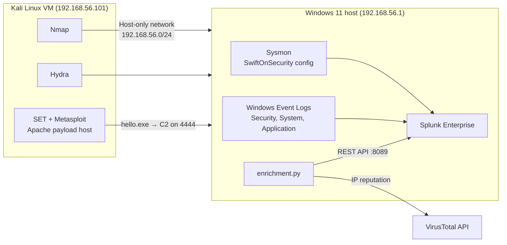

The Kali VM has two adapters: NAT (`10.0.2.15`) for updates and host-only (`192.168.56.101`) for attack traffic. The Windows 11 host runs Sysmon and Splunk, so every attack lands on the same machine that collects the telemetry.

---

## Tooling

| Category | Tools |
|---|---|
| SIEM | Splunk Enterprise (search, SPL, dashboards, REST API) |
| Endpoint telemetry | Sysmon v15.20 with the SwiftOnSecurity configuration, Windows Event Logs |
| Offensive | Kali Linux, Nmap 7.98, Hydra, Social-Engineer Toolkit (SET), Metasploit, Apache2, Mimikatz 2.2.0 |
| Virtualisation | VirtualBox (NAT + host-only networking) |
| Automation | Python 3 (`requests`), Splunk REST API, VirusTotal API v3 |
| Framework | MITRE ATT&CK |

---

## Build

1. **Attacker VM:** Kali Linux in VirtualBox with 2 CPUs, a NAT adapter and a host-only adapter on `192.168.56.0/24`. Connectivity verified with a 0% loss ping to the Windows host.
2. **Endpoint sensor:** Sysmon installed with the SwiftOnSecurity configuration to log process creation (EventCode 1), network connections (EventCode 3) and file hashes.
3. **SIEM:** Splunk Enterprise installed on the host with `inputs.conf` collecting four sources:

| Input | Contents |
|---|---|
| `WinEventLog://Security` | Logons, failed logons (4625), account changes |
| `WinEventLog://System` | Service and driver events |
| `WinEventLog://Application` | Application events |
| `WinEventLog://Microsoft-Windows-Sysmon/Operational` | Process creation, network connections, hashes |

| | |
|---|---|
| 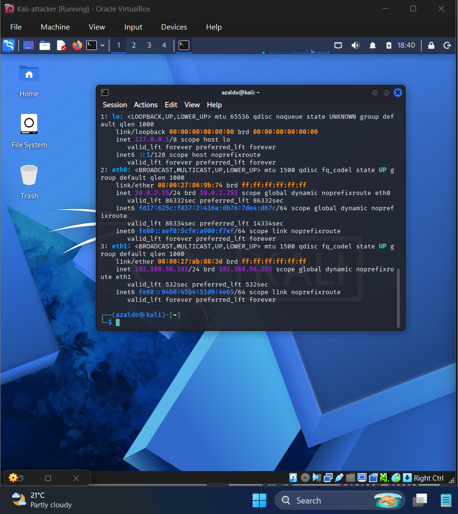 | 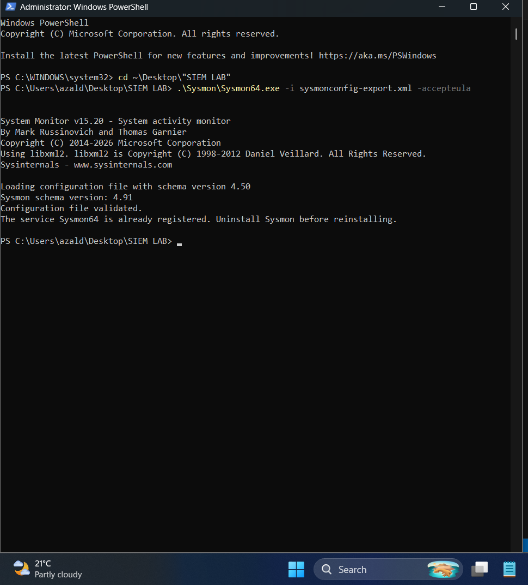 |
| Kali with NAT and host-only interfaces | Sysmon installed with SwiftOnSecurity |
| 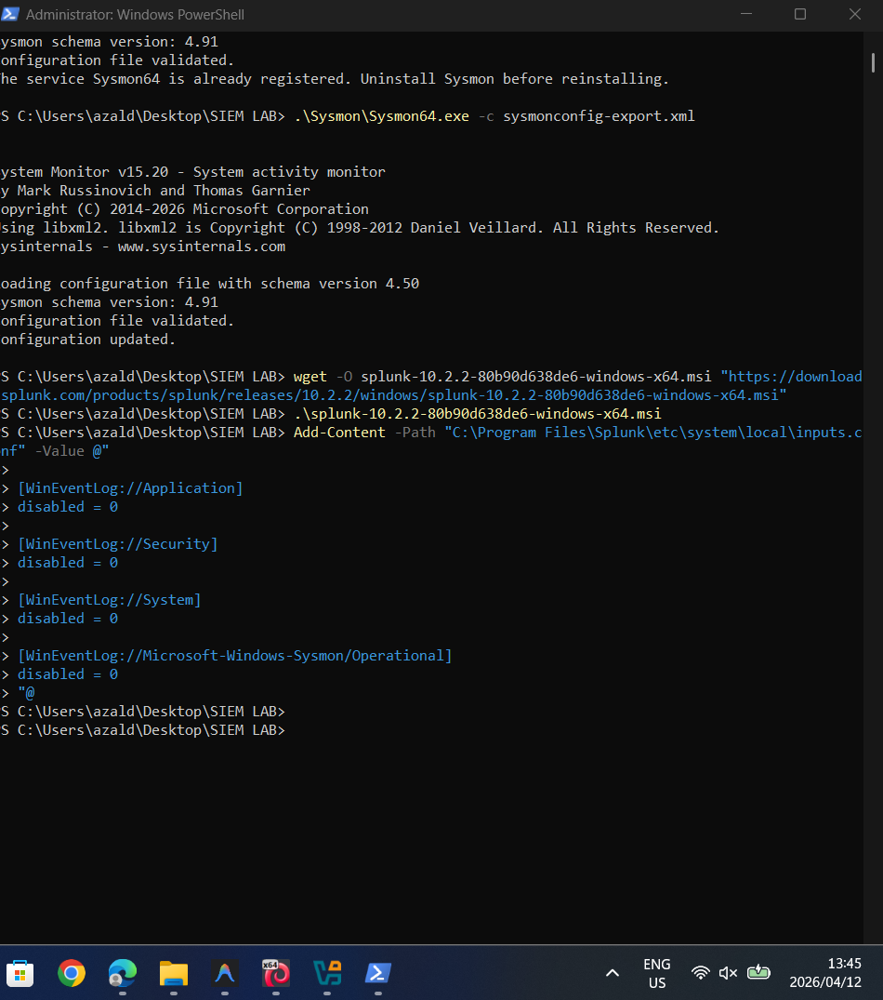 |  |
| `inputs.conf` with four log sources | Host-only connectivity verified |

---

## Attack simulation and detections

### 1. Reconnaissance: Nmap port scan (T1046)

```bash
sudo nmap -A -T4 -p- 192.168.56.1
```

A full TCP sweep generated 1,103 Sysmon network-connection events, visible as a single spike on the timeline.

```spl
index=main source="*Sysmon*" EventCode=3
| timechart span=1h count
```

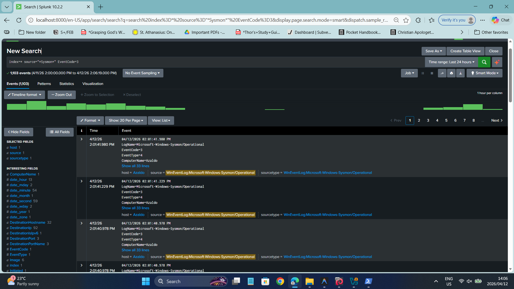

### 2. Credential access: SMB brute force (T1110)

Hydra ran 262 SMB authentication attempts against port 445, and a PowerShell loop generated further failures under the account name `Hacker`:

```powershell
1..10 | ForEach-Object { net use \\localhost\c$ /user:Hacker "FakePassword" 2>$null }
```

```spl
index=* source="*Security*" EventCode=4625
| stats count by Account_Name
```

| | |
|---|---|
| 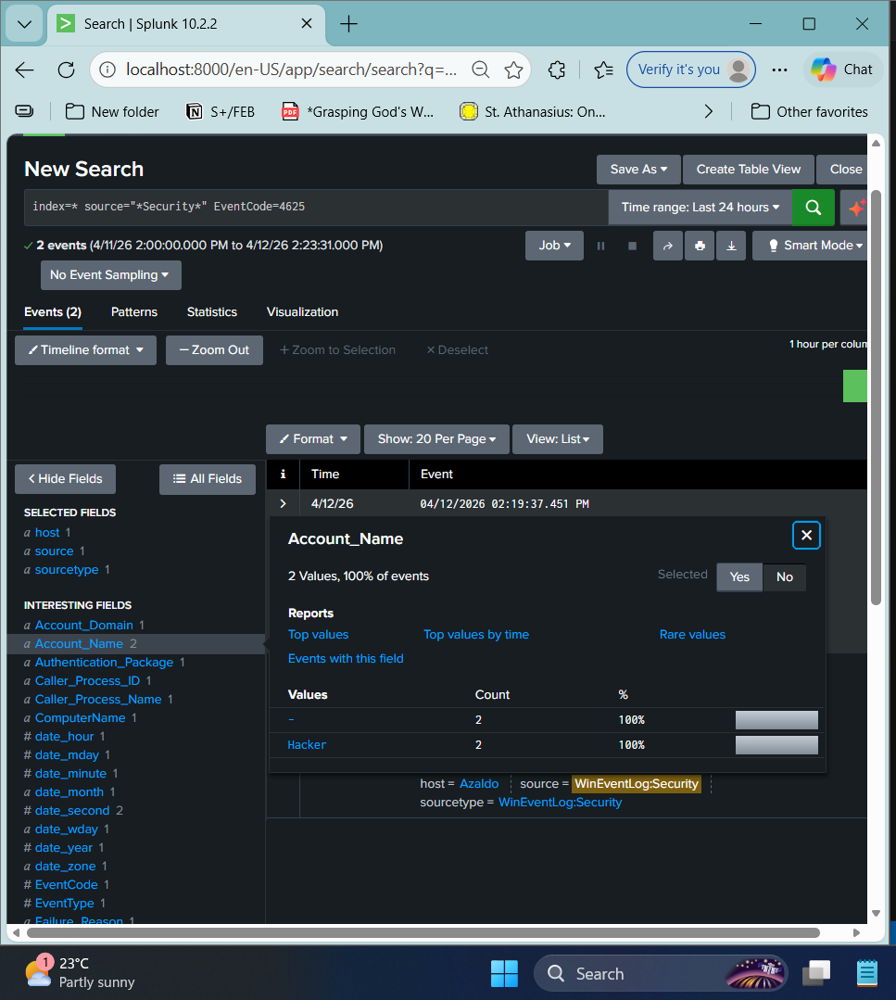 | 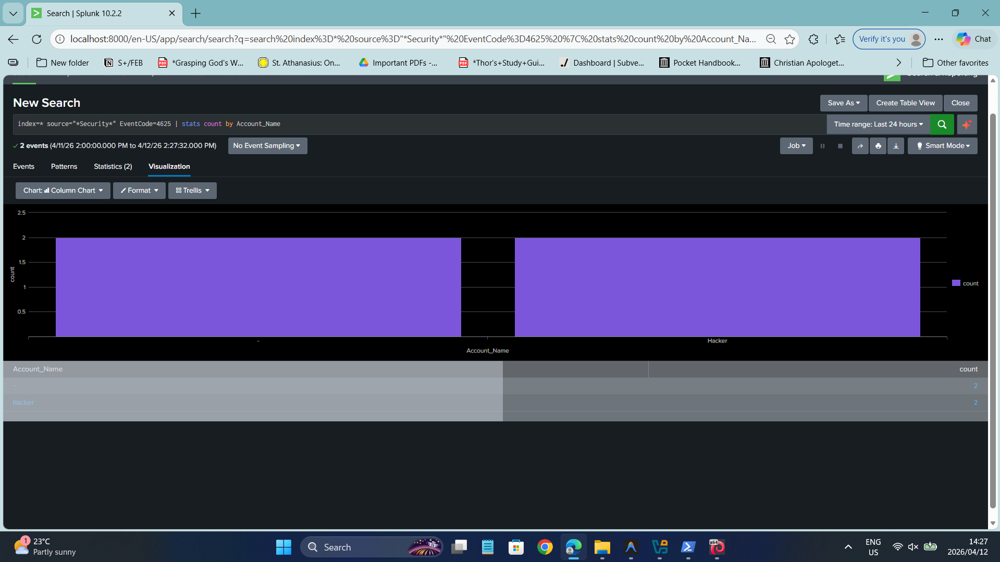 |

### 3. Execution and C2: reverse shell (T1204.002, T1571)

SET generated a Meterpreter reverse TCP payload, Apache on Kali served it as `hello.exe`, and a Metasploit handler on port 4444 received 14 sessions once it ran on the host (`whoami` returned the local user).

Sysmon recorded 3,544 related events. The key signal is `hello.exe` opening an outbound connection to `192.168.56.101:4444`:

```spl
index=main source="WinEventLog:Microsoft-Windows-Sysmon/Operational" DestinationPort=4444
| timechart count by DestinationIp
```

| | |
|---|---|
| 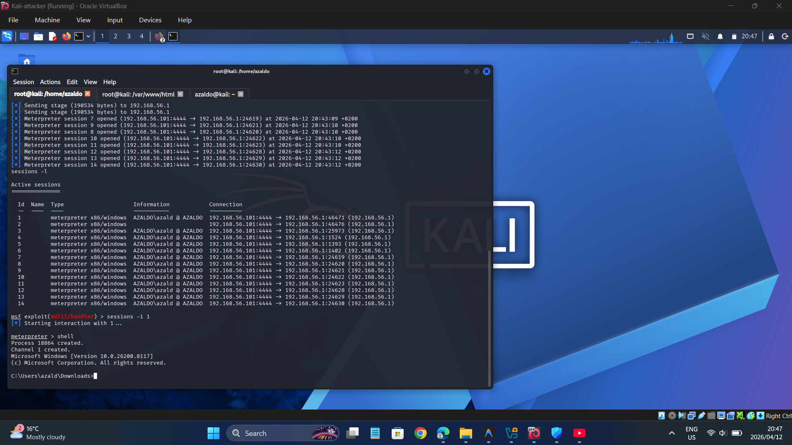 | 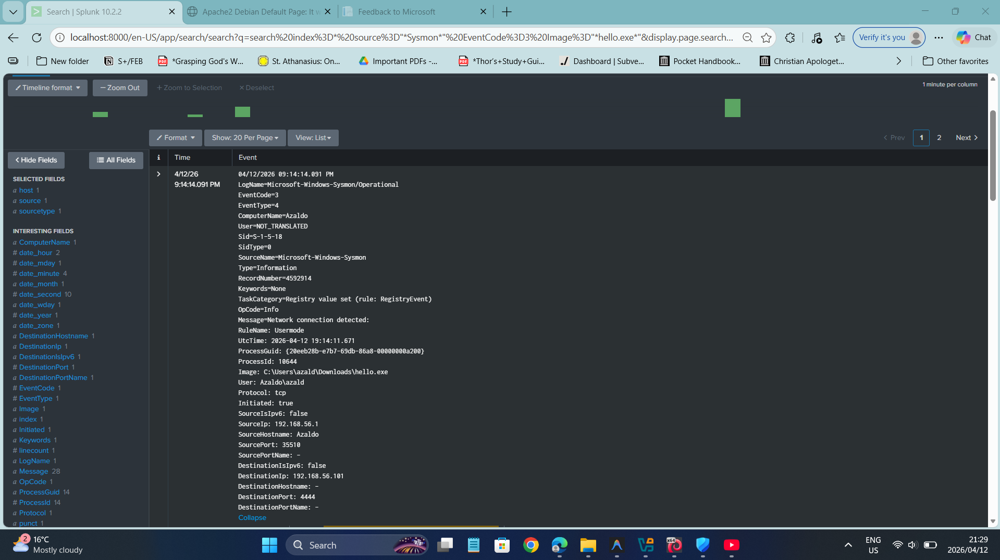 |
| 14 Meterpreter sessions | `hello.exe` → `192.168.56.101:4444` in Sysmon |

### 4. Credential dumping: Mimikatz (T1003.001)

```text
mimikatz # privilege::debug
mimikatz # sekurlsa::logonpasswords
```

Windows 11 LSA Protection blocked the LSASS read, but Sysmon still logged the execution with full metadata (company `gentilkiwi`, integrity level High, hashes, parent PowerShell). Matching on `OriginalFileName` detects the binary even if it is renamed:

```spl
index=main source="WinEventLog:Microsoft-Windows-Sysmon/Operational" EventCode=1 OriginalFileName="mimikatz.exe"
```

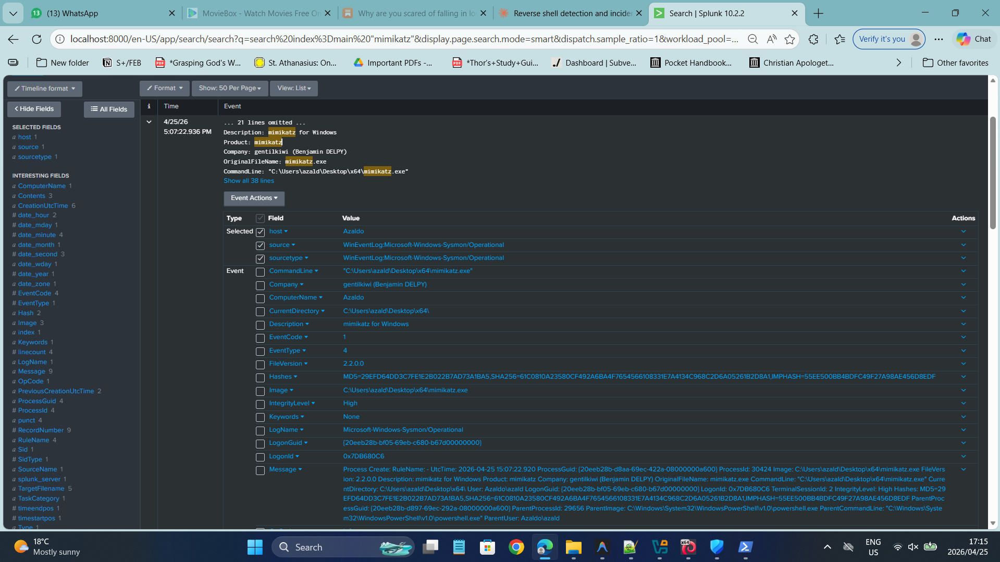

All five detection queries are in [`Splunk_Queries.txt`](splunk-siem-detection-lab/Splunk_Queries.txt).

---

## SOC dashboard

A five-panel Splunk dashboard summarises the attack chain:

| Panel | Visualisation | Purpose |
|---|---|---|
| Reverse Shell C2 Callbacks | Line chart | Port 4444 traffic over time |
| Network Connection Volume | Column chart | Sysmon EventCode 3 volume, highlighting the scan |
| Brute Force / Failed Logon Storm | Area chart | EventCode 4625 over time |
| Mimikatz Execution Detail | Table | Time, command line, image path, integrity level |
| Mimikatz Executions Detected | Single value | Count of credential-dumping attempts |

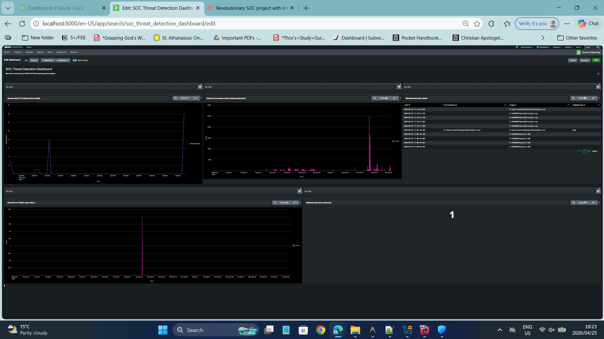

---

## Automated IOC enrichment

[`enrichment.py`](splunk-siem-detection-lab/enrichment.py) replaces the manual copy-paste step between Splunk and VirusTotal:

1. Authenticates to the Splunk REST API (`/services/auth/login`, port 8089).
2. Submits the reverse-shell detection as a search job and polls until it completes.
3. Extracts unique destination IPs and process image names from the results.
4. Queries the VirusTotal API v3 for each IP and prints malicious and suspicious counts.

On the lab data, the script processed 44 events and extracted one IP (`192.168.56.101`) and one file (`hello.exe`). VirusTotal returned zero detections, as expected for a private RFC 1918 address.

| | |
|---|---|
| 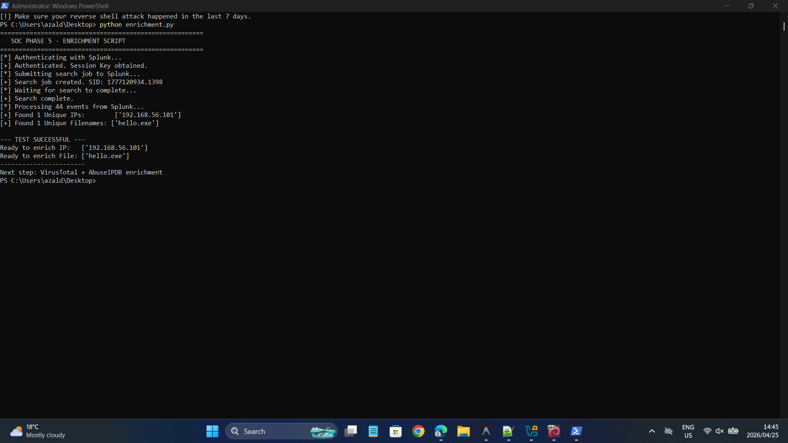 | 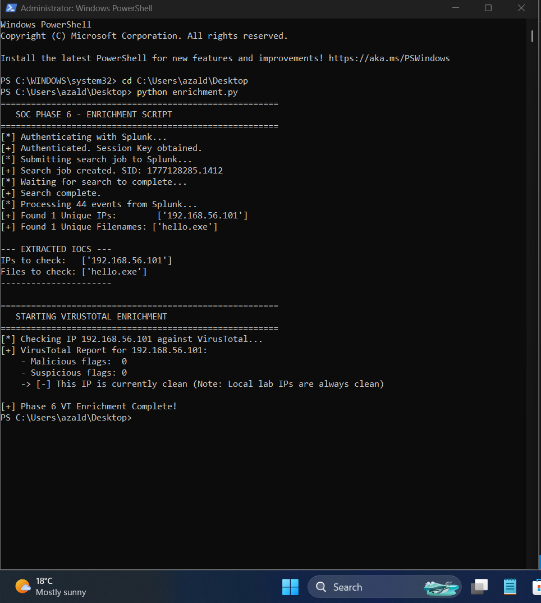 |

---

## MITRE ATT&CK coverage

| Tactic | Technique | ID | Detection |
|---|---|---|---|
| Discovery | Network Service Discovery | T1046 | EventCode 3 volume spike |
| Credential Access | Brute Force | T1110 | EventCode 4625 grouped by account |
| Execution | User Execution: Malicious File | T1204.002 | EventCode 1 for `hello.exe` |
| Command and Control | Non-Standard Port | T1571 | EventCode 3 to port 4444 |
| Credential Access | OS Credential Dumping: LSASS Memory | T1003.001 | EventCode 1 with `OriginalFileName` |

---

## Repository structure

```text
.
├── README.md
└── splunk-siem-detection-lab/
    ├── enrichment.py          # Splunk REST API + VirusTotal enrichment
    ├── Splunk_Queries.txt     # Five SPL detection queries
    ├── SOC_Lab- DOCUMENTATION WITH SCREENSHOTS - FULL PRESENTATION.pptx
    └── screenshots/           # Numbered evidence for every phase
        ├── 01–15  Lab build: VirtualBox, networking, Sysmon, Splunk
        ├── 16–21  Nmap and brute force, with detections
        ├── 22–27  Reverse shell chain, with detections
        ├── 28–30  Mimikatz detection and forensics
        ├── 31–35  Dashboard build
        └── 34–45  Enrichment script and advanced SPL
```

---

## Running the enrichment script

Credentials are read from environment variables, never from the source file.

```bash
pip install requests urllib3

export SPLUNK_HOST="https://localhost:8089"
export SPLUNK_USER="your-splunk-user"
export SPLUNK_PASS="your-splunk-password"
export VIRUSTOTAL_KEY="your-virustotal-api-key"

python splunk-siem-detection-lab/enrichment.py
```

On Windows PowerShell, use `$env:SPLUNK_PASS="..."` instead of `export`. The VirusTotal free tier allows 4 lookups per minute.

---

## Lessons learned

- **Sysmon is essential.** Native Windows logs alone miss process lineage, network connections and hashes; Sysmon supplied every detection except 4625.
- **Match on `OriginalFileName`, not `Image`.** The PE metadata survives renaming, so a renamed Mimikatz is still caught.
- **Prevention and detection are separate layers.** LSA Protection stopped the credential dump, but the attempt was still logged and alertable.
- **Port 4444 is an easy signature.** Real C2 uses 443 or 80, so this detection is a starting point; behavioural rules (rare parent–child processes, beaconing intervals) are the next step.
- **Background noise needs tuning.** Developer tools on the host (for example IDE network traffic) appeared alongside the attack and had to be filtered out during analysis.

---

## Limitations and next steps

- The victim is the same Windows host that runs Splunk, so there is no separation between monitored and monitoring systems.
- Detections are ad-hoc searches and dashboard panels, not scheduled alerts with thresholds.
- [ ] Convert the five searches into scheduled Splunk alerts with throttling.
- [ ] Add AbuseIPDB enrichment and write results to a JSON incident report.
- [ ] Move the victim to a dedicated Windows VM and forward logs with the Splunk Universal Forwarder.
- [ ] Re-run the C2 stage over port 443 and build a beaconing-based detection.
